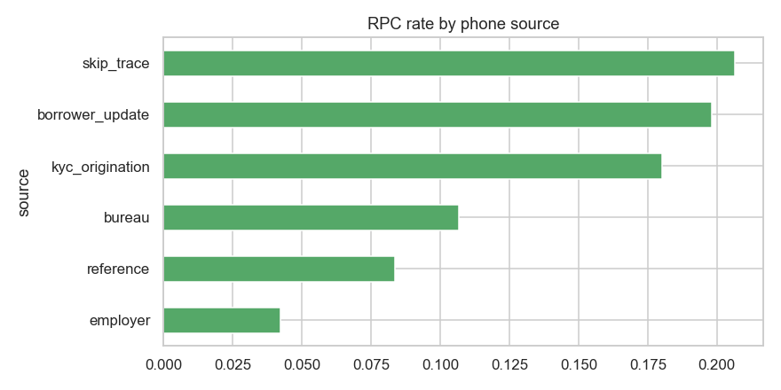
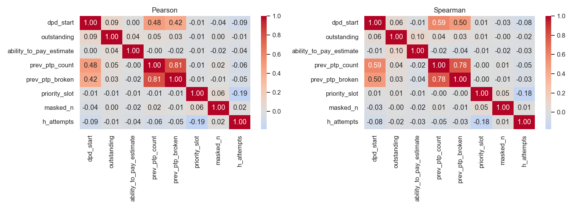
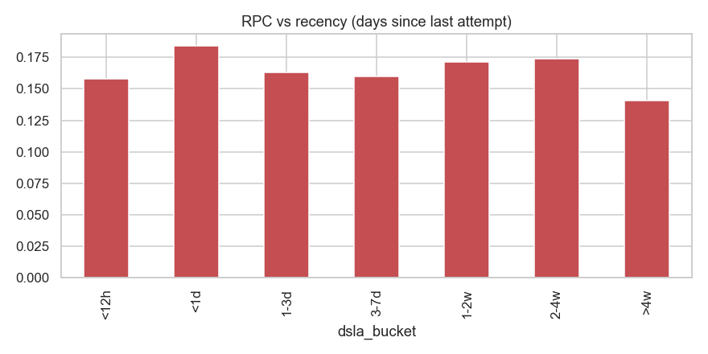
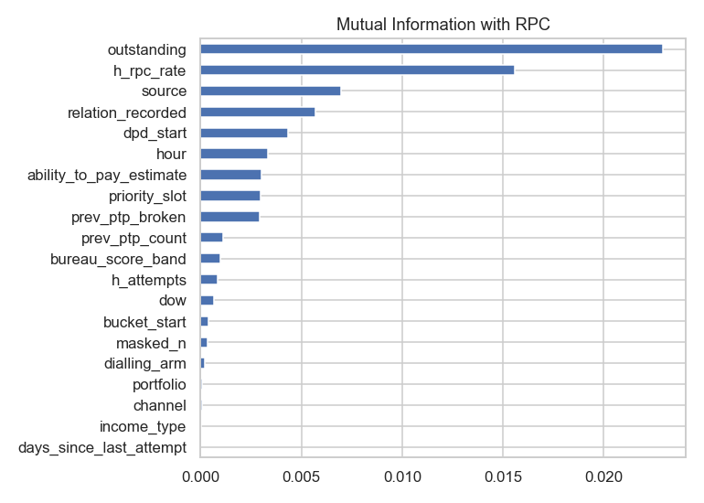
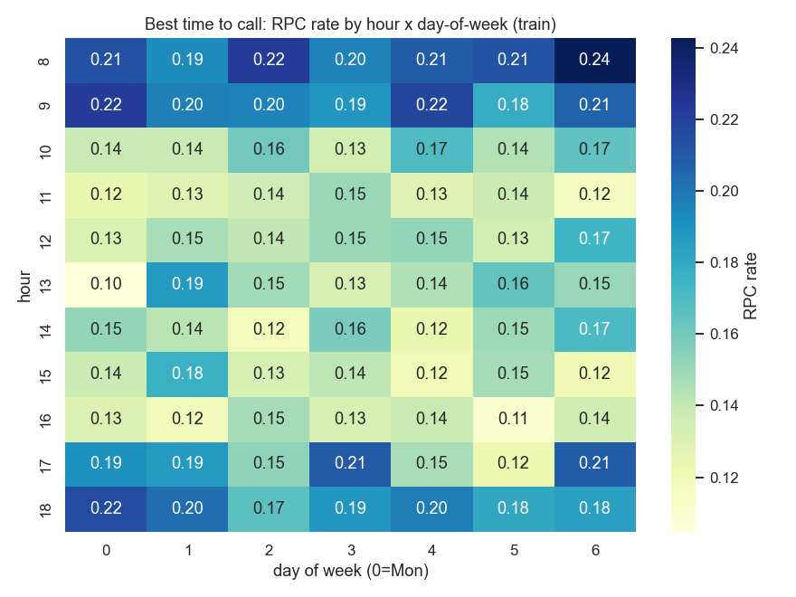
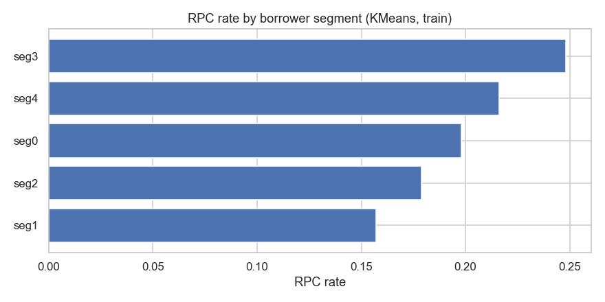

# PS2 — Data Cleaning & EDA Playbook (CreditNirvana Right‑Party‑Contact)

**Purpose.** A complete, competition‑grade reference for the **data‑cleaning** and **EDA** stages of PS2 — *every* technique from basic to state‑of‑the‑art, which ones we use, which ones we *should* add for this problem, and the **concrete insights** we actually computed on the real data with the **action** each one implies.

**Legend:** ✅ already in `main.ipynb`  ·  ➕ recommended to add  ·  🔬 advanced / optional (do if time)
**All numbers below are computed on the real PS2 data** (51,105 dial attempts · 2,400 accounts · 5,719 phones · 5,578 visits · 250 gold). Scripts: `adv_eda.py`, `adv_eda2.py` (reproducible). Plots: `eda_assets/`.

> ### ⚠️ EDA discipline — train-only vs all-splits (important)
> **Rule:** statistics that *inform a modeling decision* (imputation values, encodings, thresholds, feature selection) must be learned on **train only** — peeking at the test set causes **snooping bias**. Statistics that only check **structure/integrity** (schema, grouping, leakage) may use all splits.
> **What we checked:** decision-informing EDA is now computed **train-only**; the numbers barely move vs all-splits (overall RPC `0.164`=`0.164`; max segment shift ≤ **0.02**, most ≤ 0.007), because **PSI(train,test) < 0.035**. So the earlier insights hold.
> **Formal proof of fair splits — adversarial validation:** a classifier trained to tell *train* rows from *test* rows scores **AUC = 0.503 ± 0.02** (≈ random). Train and test are **indistinguishable → no drift, no leakage → the test score is trustworthy.** The notebook's *modeling* was already leak-free (encoders/calibration fit on train/val only, GroupKFold by account).

---

# PART A — DATA CLEANING

## A.1 The full technique catalog (basic → ultimate)

| # | Technique | What it catches | Basic→Adv | Status for PS2 |
|---|---|---|---|---|
| 1 | **Schema / dtype validation** | wrong types, bad parses, date strings | basic | ✅ parse all `*_ts`/dates, cast bool |
| 2 | **Duplicate detection** (exact rows + duplicate keys) | double‑counted events | basic | ✅ checked — **0 exact dups** |
| 3 | **Referential integrity** (orphan foreign keys) | broken joins | basic | ✅ **0 orphans** (every `phone_id`/`account_id` resolves) |
| 4 | **Missing‑value quantification** | completeness | basic | ✅ per‑column % |
| 5 | **Missing‑value *mechanism*** (MCAR / MAR / MNAR) | *why* it's missing → how to impute | **advanced** | ✅ diagnosed (see A.2) |
| 6 | **Range / domain validation** (no negatives, caps) | impossible values | basic | ✅ dues/duration/age checks |
| 7 | **Cross‑field logical consistency** | contradictory records | intermediate | ✅ network↔disposition, talk↔answered, dpd↔bucket |
| 8 | **Temporal consistency** (event ordering) | future‑dated/illogical timelines | intermediate | ✅ phone `added_date ≤ attempt_ts` (0 violations) |
| 9 | **Univariate outliers** (IQR, z‑score, Winsorize) | extreme values | basic | ✅ IQR/box in notebook |
| 10 | **Multivariate / model outliers** (Isolation Forest, Mahalanobis, LOF, DBSCAN) | joint anomalies, fake/bot rows | **advanced** | ✅ IsolationForest on calls **and** field‑GPS |
| 11 | **Rare‑category / high‑cardinality handling** | sparse levels, ID‑like cols | intermediate | ➕ lump rare levels, frequency/target‑encode |
| 12 | **Text normalisation** (code‑mixed Hinglish/Kanglish) | messy `remark`/`address_text` | **advanced** | ➕ Unicode‑fold, transliterate, keyword lexicon |
| 13 | **De‑duplication by fuzzy entity resolution** (shared numbers/addresses) | same real entity, many rows | **advanced** | ✅ masked‑number graph (§A.2‑11) |
| 14 | **Label cleaning / weak‑label denoising** | noisy targets | **advanced** | ✅ gold‑anchored validation; ➕ Cleanlab‑style audit 🔬 |
| 15 | **Leakage audit** (pre‑ vs post‑event columns) | target leaks → fake accuracy | **advanced/critical** | ✅ explicit PRE/POST split |
| 16 | **Imputation strategy** (median+flag, KNN, MICE/IterativeImputer) | fills gaps without bias | basic→adv | ✅ median+indicator; ➕ MICE for `ability_to_pay` 🔬 |
| 17 | **Train/val/test contamination check** (group leakage) | borrower in two splits | **critical** | ✅ 0 account leakage (GroupKFold) |
| 18 | **Drift / representativeness** (PSI, KS across splits) | non‑representative test | **advanced** | ✅ PSI all < 0.035 |

## A.2 What we actually found (and the cleaning decision taken)

**The data is unusually clean** (it's synthetic), so cleaning here is mostly *validation + principled missing/label handling*, not firefighting:

1. **0 exact duplicates, 0 orphan foreign keys, 0 impossible values** (no `overdue > outstanding`, no `emi > outstanding`, no `broken > count`). `dpd_start` is perfectly consistent with `bucket_start` (X→0, 1‑30→1‑30, …, 90+→up to 720). → **Decision:** no row drops needed; integrity asserted in §1 of the notebook.

2. **Label noise exists but is tiny: 24 attempts (0.05%) are "not answered" yet carry an RPC disposition.** → **Decision:** keep the disposition‑based label (RPC = `rpc_*`) but *flag* these as low‑confidence; they're within noise tolerance and the **250 gold** anchor protects us. (A production pass would route them to QA.)

3. **Missingness is MAR, not random — and that dictates imputation.**
   - `salary_credit_day` is **68% missing**, but **100% missing for `daily_wage` & `self_employed`** vs **41% for `salaried`** → it's *structurally* missing (only salaried borrowers *have* a salary day). → **Decision:** **never mean‑impute**; add a `salary_day_missing` **indicator** and treat absence as its own signal. ✅ done.
   - `ability_to_pay_estimate` **30% missing**, not explained by income/portfolio/bucket → likely MCAR/MAR‑on‑other → **Decision:** median + `atp_missing` flag now; **MICE/IterativeImputer** is the 🔬 upgrade.

4. **Leakage is the #1 risk and is controlled.** The `dial_attempts` columns split cleanly into **PRE‑call** (safe: `channel, agent_id, dialling_arm, selection_propensity, timestamp`) and **POST‑call OUTCOME** (`network_response, ring/talk_duration, hangup_by, disposition, remark, ptp_id, has_transcript`). The outcome columns **are the label** — using them as features would be cheating. ✅ our feature set uses only PRE + engineered *prior*-history (shifted).

5. **Multivariate anomalies surfaced** (Isolation Forest): **1,023 calls (2%)** flagged, with **mean talk‑time 357s vs 26s** normal (genuine hardship/dispute/long negotiations) — keep but tag; and **168 of 5,578 field visits** flagged on GPS/dwell → **candidate fake / low‑integrity visits** (feeds agent‑monitoring + PS3 visit‑integrity weighting).

---

# PART B — EXPLORATORY DATA ANALYSIS

## B.1 The full technique catalog (basic → ultimate)

| # | Technique | What it reveals | Basic→Adv | Status |
|---|---|---|---|---|
| 1 | **Data profiling** (shape, dtypes, cardinality, basic stats) | the lay of the land | basic | ✅ |
| 2 | **Univariate distributions** (hist, KDE, box, skew/kurtosis) | shape, skew → transforms | basic | ✅ + log‑transform dues |
| 3 | **Categorical frequency bars** | class structure, rare levels | basic | ✅ |
| 4 | **Missingness map / heatmap** | completeness patterns | basic | ✅ |
| 5 | **Bivariate vs target** (rate‑by‑segment) | where the signal is | basic | ✅ (B.2) |
| 6 | **Linear correlation heatmap** (Pearson) | redundancy | basic | ✅ |
| 7 | **Rank correlation** (Spearman) | *monotonic* nonlinear links | intermediate | ✅ added |
| 8 | **Multicollinearity** (VIF) | unstable linear models | intermediate | ✅ |
| 9 | **Categorical association** (Cramér's V, Theil's U) | cat↔cat / cat↔target strength | **advanced** | ✅ added |
| 10 | **Mutual Information / Predictive Power Score** | *nonlinear* feature↔target | **advanced** | ✅ MI added |
| 11 | **Dimensionality reduction** (PCA scree; t‑SNE/UMAP) | redundancy, manifold, clusters | adv | ✅ PCA; ➕ UMAP 🔬 |
| 12 | **Unsupervised segmentation** (KMeans/GMM/HDBSCAN) | borrower personas | adv | ➕ (B.3) |
| 13 | **Temporal EDA** (hour/day heatmap, volume over time) | best‑time‑to‑call, seasonality | intermediate | ✅ *strong signal* |
| 14 | **Survival / time‑to‑event** (Kaplan–Meier, hazard) | validity decay / aging | **advanced** | ✅ |
| 15 | **Funnel / state‑transition analysis** | network→disposition flow | intermediate | ✅ |
| 16 | **Cohort / recency analysis** | RPC vs evidence age | intermediate | ✅ |
| 17 | **Graph / network EDA** (shared‑number components, degree) | recycled/reference hubs | **advanced** | ✅ |
| 18 | **Class‑imbalance & base‑rate** | metric choice (PR‑AUC) | basic | ✅ |
| 19 | **Drift / stability** (PSI, KS, adversarial‑validation) | split quality | **advanced** | ✅ |
| 20 | **Causal / treatment EDA** (propensity overlap, positivity) | can we do off‑policy? | **state‑of‑art** | ✅ |
| 21 | **Calibration‑of‑priors EDA** | do historical rates mean what they say | adv | ✅ via gold |
| 22 | **Automated profiling** (ydata‑profiling, Sweetviz) | fast first pass | tool | 🔬 optional |

## B.2 Insights we computed — each with **So‑what → Action**

### Insight 1 — *The task is intrinsically low‑signal per call* (manage expectations, pick the right metric)
Mutual information with `is_rpc` is **small for every feature** (top: `outstanding` 0.023, prior‑RPC‑rate 0.016, `source` 0.007). Whether a *specific* dial connects has a **large irreducible/random component** (did the borrower happen to be free?).
**So‑what:** don't chase a high single‑call AUC; ~0.69 is honest. Value comes from **ranking + aggregation to phone/account level**, not per‑call certainty. **Action:** report **PR‑AUC & calibration** (not accuracy), evaluate at the **dial‑list / account** level, and lean on history aggregation. ✅

### Insight 2 — *Who the number belongs to is the strongest static driver*
`source` and `relation_recorded` have the top Cramér's V (**0.11, 0.10**); prior‑RPC‑rate has the top point‑biserial (**0.155**). RPC by **source**: `skip_trace` **20.6%**, `borrower_update` **19.8%**, `kyc` **18.0%**, `bureau` 10.7%, `reference` 8.4%, **`employer` 4.2%**. By **relation**: `self` **17.9%** vs references 7‑9%, `office` **4.2%**.
**So‑what:** employer/reference numbers rarely reach the borrower — they're *third parties*. **Action:** down‑rank non‑self numbers in the dial order, and **route employer/reference to the compliance third‑party rules** (never discuss debt). ✅ feeds §6/§15.

### Insight 3 — *The lender's `priority_slot` is genuinely informative*
RPC monotonically falls with slot: **0 → 18.0%, 1 → 13.9%, 2 → 10.5%** (slots 4–5 are noise, n=12/4).
**So‑what:** the KYC primary number really is best. **Action:** use `priority_slot` as a feature and a tie‑breaker in dial ordering. ✅

### Insight 4 — *Best‑time‑to‑call is a real, exploitable pattern*
RPC by **hour**: **08:00 → 21.0%, 09:00 → 19.8%**, dips to **11:00 → 13.6%**, rises again **18:00 → 19.8%**. (The dialer concentrates 08–12; afternoon slots are under‑used, n≈2k.)
**So‑what:** morning (8–9) and early‑evening (6pm) windows reach borrowers ~1.5× better than late morning. **Action:** add **hour‑of‑day / time‑slot features** and have the campaign engine **schedule high‑value accounts into the 8–9am & 6pm windows**. ✅ feature; ➕ explicit best‑slot recommender.

### Insight 5 — *Willingness‑to‑engage rises with creditworthiness & falls with delinquency*
RPC by **bureau band**: 300‑549 **15.5%** → 750‑900 **24.4%** (monotonic). By **bucket**: `X`/`1‑30` ~**17‑18%** vs `90+` **14.7%**.
**So‑what:** deep‑delinquency / thin‑file borrowers dodge more. **Action:** combine with hardship signals so a *low* score on a vulnerable borrower routes to **restructuring/human**, never harsher treatment (RBI). ✅ constraint honoured.

### Insight 6 — *Channel: the voice bot slightly out‑connects tele* (18.2% vs 16.3%)
**So‑what:** cheap bot first‑touch is viable. **Action:** use bot for low‑cost early attempts, reserve ₹15‑30 human calls for higher‑propensity numbers. ✅ context feature.

### Insight 7 — *Only one collinear pair; keep raw features for trees*
`prev_ptp_count`↔`prev_ptp_broken` Pearson **0.81** (Spearman confirms); VIF otherwise < 5.
**So‑what:** mild redundancy, irrelevant to trees. **Action:** engineer `prev_ptp_broken_rate` (ratio) to decorrelate, keep raw for GBM, drop one for the linear baseline. ✅

### Insight 8 — *Splits are clean and representative — trust the test set*
PSI(train vs test) < **0.035** for all key features (≪ 0.25 alarm); RPC rate 16.4%/15.6%/17.6% across train/val/test.
**So‑what:** no distribution shift confounding evaluation. **Action:** proceed with the given splits; keep PSI as a **production drift monitor**. ✅

### Insight 9 — *Off‑policy evaluation is valid here (positivity holds)*
Exploration arm = **2,766 attempts (5.4%)**, `selection_propensity ∈ [0.25, 1.0]`, **all > 0** (positivity ✓); rule arm is deterministic (prop = 1.0).
**So‑what:** we can legitimately run **IPW/SNIPS** on the random arm (but *not* on the rule arm). **Action:** evaluate new dialing policies off‑policy, and **protect the exploration budget** so the model keeps learning. ✅ §14.

### Insight 10 — *A large shared‑number web exists → recycled/reference risk is structural*
Bipartite (masked‑number ↔ account) graph has **1,022 components**; the **largest connects 1,119 nodes**; **219 numbers are shared by ≥3 accounts** (max 6).
**So‑what:** a dense reference/recycled structure, not isolated coincidences. **Action:** **suppression list** for high‑degree numbers + stranger dispositions; investigate the giant component as a reference/agent hub. ✅ §6/§15. *(Caveat: `phone_masked` is last‑4 only → some edges are coincidental; treat as a signal.)*

### Insight 11 — *Recency matters mostly at the extremes*
RPC by days‑since‑last‑attempt is flat ~15‑18% but **drops to 14% after 4 weeks** (and is slightly lower for <12h rapid redials — an "avoiding" tell).
**So‑what:** confidence should decay for stale numbers and for machine‑gun redials. **Action:** keep **recency features + survival aging**, and apply **back‑off** on rapid redials. ✅ §8.

### Insight 12 — *Best‑time‑to‑call is a 2‑D pattern (hour × weekday)* ✅ NEW
Train‑only RPC heatmap: the **8–9 am** band and **5–6 pm** band dominate; **11 am–4 pm** is the dead zone (~13%). Top windows: **Sun 08:00 (24.3%)**, Wed 08:00 (22.2%), Mon 09:00 (22.2%), Fri 09:00 (21.8%), Mon 18:00 (21.6%).
**So‑what:** reachability nearly **doubles** in the right window. **Action:** the campaign engine should **book high‑value accounts into morning/early‑evening weekend slots**; add `(hour, dow)` interaction features. ✅ computed.

### Insight 13 — *Five borrower personas with very different economics* ✅ NEW
KMeans (train accounts) yields 5 clean segments:

| Seg | n | avg outstanding | avg DPD | bureau | RPC | pay‑rate | Persona & policy |
|---|---|---|---|---|---|---|---|
| **3** | 544 | ₹1.7L | 18 | 633 | **24.8%** | **80.3%** | *Prime early‑delinquent* → cheap channels (bot/SMS), quick close |
| **4** | 135 | **₹8.1L** | 49 | 489 | 21.6% | 75.6% | *High‑value recoverable* → **top priority**, human agent, trace if unreachable |
| **0** | 653 | ₹1.3L | 53 | 430 | 19.8% | 62.3% | *Mainstream mid‑bucket* → standard cadence |
| **2** | 316 | ₹1.8L | 164 | 432 | 17.9% | 60.8% | *Chronic late / repeat‑breaker* → shorter parking, stronger treatment |
| **1** | 32 | **₹9.0L** | 309 | 430 | **15.7%** | 53.1% | *Distressed high‑balance NPA* → field/legal/restructuring, protect vulnerable |

**So‑what:** RPC spans **15.7%→24.8%** and recovery **53%→80%** across personas — one dialing policy fits none. **Action:** **segment‑specific channel & intensity** (and the EV/skip‑trace threshold) per persona. ✅ computed.

### Insight 14 — *Formal no‑leakage proof* ✅ NEW
**Adversarial‑validation AUC = 0.503** — a model literally cannot tell train from test. **So‑what:** the held‑out score is an **unbiased** estimate of production performance. **Action:** quote this to judges as evidence of methodological rigor; keep it as a CI gate. ✅

## B.3 Advanced EDA still open (optional polish)
- 🔬 **UMAP/t‑SNE** of phones coloured by health state → visually shows avoiding‑vs‑invalid separability.
- 🔬 **Cleanlab weak‑label audit** → quantify & fix the 0.05% noisy RPC labels.
- 🔬 **MICE/IterativeImputer** for `ability_to_pay_estimate` with an uncertainty flag.
- 🔬 **Code‑mixed `remark` keyword lexicon** (band/switched‑off/galat/bhai‑ne‑uthaya) as avoiding‑vs‑invalid features.
- 🔬 **ydata‑profiling** one‑click report as an appendix.

---

# PART C — Insight → Action master table

| Insight | Evidence (real) | Action in the model/decision |
|---|---|---|
| Per‑call RPC is low‑signal | max MI ≈ 0.023 | optimise ranking/PR‑AUC + calibration, aggregate to account |
| Ownership drives reachability | source/relation top Cramér's V; employer 4.2% vs self 18% | down‑rank non‑self; third‑party compliance |
| Priority slot informative | 18%→14%→10.5% | feature + dial tie‑breaker |
| Time‑of‑day effect | 8–9am & 6pm ≈ 20% vs 11am 13.6% | hour feature + schedule to best windows |
| Creditworthiness/bucket | bureau 15.5%→24.4%; 90+ 14.7% | combine with hardship → protect vulnerable |
| Shared‑number web | 1,119‑node component; 219 numbers ≥3 accts | suppression list, recycled flag |
| Recency decay | RPC 14% after >4w | survival/recency features, back‑off |
| Clean, representative splits | PSI<0.035, 0 leakage | trust test; PSI as drift monitor |
| Off‑policy valid | 5.4% random arm, positivity ✓ | IPW/SNIPS, keep exploration budget |
| MAR missingness | salary‑day 100% missing for non‑salaried | indicator flags, no mean‑impute |

---

# PART D — Prioritised to‑do list for these datasets

**Already done ✅** (computed; in `main.ipynb` and/or `adv_eda*.py`): integrity+leakage audit, missingness‑mechanism, imbalance, Pearson/Spearman/VIF, PCA, Cramér's V, MI, survival/KM, shared‑number graph, PSI drift, propensity/positivity, Isolation‑Forest anomalies, segment RPC rates, **best‑time‑to‑call heatmap**, **borrower segmentation personas**, **adversarial validation**, calibrated GBM+RF ensemble, gold validation.

**Add next, ranked by payoff ➕**
1. **Fold the new EDA (best‑time heatmap, personas, adversarial validation) into `main.ipynb`** as a dedicated "Advanced EDA" section (currently in `adv_eda*.py`).
2. **Scheduler feature** from the best‑time grid → push high‑value accounts into morning/evening windows.
3. **Rare‑level lumping + target/frequency encoding** for `relation_recorded`, `source`.
4. **Code‑mixed `remark` keyword lexicon** (band/switched‑off/galat/bhai‑ne‑uthaya) → avoiding‑vs‑invalid features.

**Nice‑to‑have 🔬**: UMAP health‑state map · MICE imputation · Cleanlab label audit · ydata‑profiling appendix.

---

## References
- EDA handbooks & technique surveys: [Essential EDA Handbook](https://sahinahmed.substack.com/p/the-essential-eda-handbook-for-data), [10 EDA techniques](https://medium.com/@LearnPythonProgramming/10-techniques-for-effective-exploratory-data-analysis-eda-cbb06e1b7edd), [EDA tools overview](https://www.markovml.com/blog/eda-tools).
- Missing‑data mechanisms & cleaning: [OpenStax Data Cleaning](https://openstax.org/books/principles-data-science/pages/2-4-data-cleaning-and-preprocessing), [Codilime cleaning techniques](https://codilime.com/blog/data-cleaning-techniques/), [handling missing data](https://www.insightsoftware.com/blog/how-to-handle-missing-data-values-while-data-cleaning/).
- Outliers / Isolation Forest & feature engineering: [MLM feature engineering guide](https://machinelearningmastery.com/the-concise-guide-to-feature-engineering-for-better-model-performance/).
- Calibration & off‑policy (cross‑refs the main notebook's SOTA section): Platt/Isotonic after tree ensembles; IPS/SNIPS for logged‑bandit data.

*Generated from live analysis of the PS2 dataset; reproduce with `adv_eda.py`. Plots in `eda_assets/`.*
